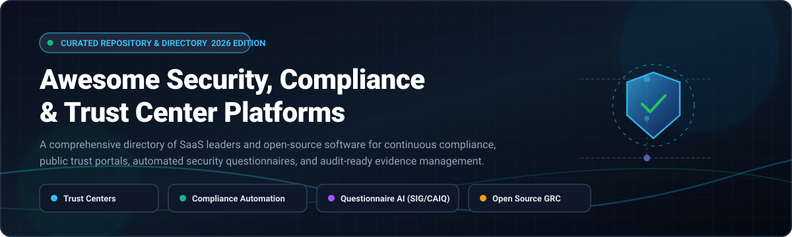

  

# 🛡️ Awesome Security, Compliance & Trust Center

  
  
  
  
  
  
  

> 🎯 A curated directory of premier **Security, Compliance, and Trust Center platforms** — covering commercial SaaS market leaders and self-hosted open-source software for showcasing security posture, continuous SOC 2 / ISO 27001 compliance automation, AI security questionnaire answering, and verifiable audit evidence management.

🌟 **Star this repository if you find it helpful!** 🌟

---

## 📋 Table of Contents

- [🌐 Sector Overview & Market Dynamics](#-sector-overview--market-dynamics)
- [🟦 SaaS / Hosted Platforms](#-saas--hosted-platforms)
  - [📊 Commercial SaaS Comparison Matrix](#-commercial-saas-comparison-matrix)
  - [🔍 SaaS Platform Deep Dives](#-saas-platform-deep-dives)
- [🟩 Open-Source Software](#-open-source-software)
  - [⭐ Open-Source Solutions by Star Count](#-open-source-solutions-by-star-count)
  - [🔬 Open-Source Project Deep Dives](#-open-source-project-deep-dives)
- [⚖️ Feature Comparison Matrix](#️-feature-comparison-matrix)
- [📈 Star History](#-star-history)
- [💖 Support & Sponsorship](#-support--sponsorship)
- [🤝 Contributing](#-contributing)
- [📄 License](#-license)

---

## 🌐 Sector Overview & Market Dynamics

The global Governance, Risk, and Compliance (GRC) and Trust Management market is valued at approximately **$58B–$65B+** and is projected to expand past **$82 Billion by 2026** (~10–14% CAGR), with cloud-native compliance automation and customer trust centers growing at an accelerated **25%–31% CAGR** 🚀. 

Market structure exhibits a **hybrid dynamic**: the legacy enterprise tier (complex ERP/financial risk management) is **moderately concentrated** among incumbents like ServiceNow and SAP, whereas the modern compliance automation and security trust portal sector is **highly fragmented and hyper-competitive** ⚡, characterized by rapid innovation across venture-backed challengers and emerging open-source self-hosted alternatives.

---

## 🟦 SaaS / Hosted Platforms

Commercial, cloud-hosted Security, Compliance, and Customer Trust Center platforms sorted in descending order by enterprise valuation and scale.

### 📊 Commercial SaaS Comparison Matrix

| Platform | Company Valuation / Revenue | Starting Price | Free Tier / Free Trial Limits | Key Capabilities |
| :--- | :--- | :--- | :--- | :--- |
| **[OneTrust](https://www.onetrust.com/)** | 🏢 **$4.5B – $5.3B Valuation** *(~$550M ARR)* | 💰 **$10,000 / year** *(platform minimum for baseline modules)* | 🔒 **No free tier**; No self-serve trial *(sales demo & pilot sandbox by request)* | Enterprise Trust Center, privacy governance, cookie consent, vendor risk management (TPRM), data mapping. |
| **[Vanta](https://www.vanta.com/)** | 🏢 **$4.2B Valuation** *(~$300M ARR)* | 💰 **$14,000 / year** *(Essentials tier on AWS Marketplace; ~$7.5k–$12k for seed startups)* | 🔒 **No free tier**; No public self-service trial *(guided sales demo & evaluation sandbox)* | Automated SOC 2, ISO 27001, HIPAA evidence collection, public Trust Center with draft/publish previews, vendor risk. |
| **[Drata](https://drata.com/)** | 🏢 **$2.0B Valuation** *(~$328M total funding)* | 💰 **$7,500 – $10,000 / year** *(Foundation plan; median contract ~$24k/year)* | 🔒 **No free tier**; Guided sandbox available on case-by-case basis during sales demo | Continuous automated compliance monitoring, native Trust Center (SafeBase integration), audit-ready evidence workflows. |
| **[SafeBase](https://safebase.io/)** *(Acquired by Drata)* | 🏢 **$100M – $250M Valuation** *(~$10M+ ARR, $53M raised prior to acquisition)* | 💰 **$5,000 – $7,500 / year** *(Advanced & Enterprise tiers)* | 🎁 **Free Foundation Tier ($0/yr)**: 1 branded Trust Center, clickwrap NDAs, Drata file sync, Slack/Teams alerts *(excludes AI questionnaire engine & CRM sync)* | Dedicated Trust Center portal, AI-assisted trust center setup, multi-product security posture, questionnaire review log. |
| **[TrustArc](https://trustarc.com/)** | 🏢 **$60M – $80M ARR** *(Acquired by Main Capital; $107M total funding)* | 💰 **$10,000 / year** *(module-based starting tier)* | ⏳ **No free tier**; **30-Day Free Trial** available for specific modules upon guided sales request | Privacy certifications, Trust Center directory, regulatory assessments (GDPR, CCPA/CPRA, Nymity privacy intelligence). |
| **[Conveyor](https://www.conveyor.com/)** | 🏢 **$40M Total Funding** *(SignalFire Series B)* | 💰 **$9,600 / year** *(Business plan with unlimited seats & automation credits)* | 🎁 **Free Trust Center Tier ($0/mo)**: Basic hosted trust portal for up to 15 compliance docs *(excludes AI auto-answer & custom domain)* | AI security questionnaire automation (SIG, CAIQ), customer trust portal, vendor review workflows. |
| **[Whistic](https://www.whistic.com/)** | 🏢 **$10M – $11.5M ARR** *(~$71M total funding)* | 💰 **$12,700 – $15,500 / year** *(entry-level assessment package)* | 🎁 **Free Vendor Profile Tier**: Basic public security profile in Trust Catalog; 30-day trial for compliance automation add-on | Vendor security assessment network (TPRM), Trust Catalog profile publishing, automated questionnaire response. |

---

### 🔍 SaaS Platform Deep Dives

#### 🏢 OneTrust
- **Type:** Enterprise privacy, compliance, and trust governance suite 🌐
- **Overview:** OneTrust powers trust intelligence across thousands of global enterprises. Its Trust Center capability allows organizations to transparently disclose security, privacy, and ESG initiatives, integrated with consent management, third-party risk management (TPRM), and AI governance frameworks.
- **Starting Price:** ~$10,000/year platform minimum for entry implementations.
- **Trial / Tier Limits:** No self-serve free tier. Tailored demo sandbox arranged during enterprise procurement.

#### 🏢 Vanta Trust Center
- **Type:** Trust Center within automated compliance platform ⚡
- **Overview:** Vanta pioneered continuous compliance automation for fast-growing companies. Its Trust Center module extends automated evidence collection directly into a customer-facing security portal with strict draft/preview workflows, visitor engagement analytics, and auto-NDA gating.
- **Starting Price:** ~$14,000/year (Essentials tier; early-stage startups start near $7,500–$12,000).
- **Trial / Tier Limits:** No free plan or self-serve trial. Available through guided sales consultation.

#### 🏢 Drata Trust Center
- **Type:** Continuous audit automation and security posture platform 🛡️
- **Overview:** Drata integrates with cloud infrastructure, HRIS, and developer tools to continuously monitor security controls for SOC 2, ISO 27001, HIPAA, and PCI DSS. The Drata Trust Center synchronizes approved files and active controls to a customer-facing portal.
- **Starting Price:** ~$7,500–$10,000/year for baseline foundation packages.
- **Trial / Tier Limits:** No perpetual free tier; guided evaluation sandbox provided during product demonstrations.

#### 🏢 SafeBase
- **Type:** Dedicated Trust Center platform with AI questionnaire automation 🤖
- **Overview:** SafeBase specializes in buyer-facing security hubs and AI-driven questionnaire acceleration. Features Multi-Product Trust Centers, AI-Assisted Trust Center content creation, and an append-only Answer History Log. Acquired by Drata in early 2025.
- **Starting Price:** ~$5,000–$7,500/year for Advanced tiers.
- **Trial / Tier Limits:** **Free Foundation Tier** ($0) provides a branded Trust Center with electronic clickwrap NDAs, Slack/Teams alerts, and Drata document sync (omits AI questionnaire answering and CRM integrations).

#### 🏢 TrustArc
- **Type:** Global privacy compliance management and certification directory 📜
- **Overview:** Specializes in comprehensive privacy risk assessments, data privacy certifications, and compliance directory hosting for complex multi-jurisdictional mandates (GDPR, LGPD, CCPA).
- **Starting Price:** ~$10,000/year.
- **Trial / Tier Limits:** No free tier; offers a 30-day evaluation trial for research and assessment modules upon sales verification.

#### 🏢 Conveyor
- **Type:** AI security questionnaire answering and customer trust portal 📑
- **Overview:** Combines a secure document repository with agentic AI models trained to auto-fill security reviews, SIG questionnaires, and RFPs directly from uploaded security collateral.
- **Starting Price:** ~$9,600/year for the Business plan.
- **Trial / Tier Limits:** **Free Trust Center Tier** provides a free customer trust portal hosting up to 15 security documents with NDA gating (no AI questionnaire automation).

#### 🏢 Whistic
- **Type:** Third-party vendor risk assessment exchange and Trust Catalog 🤝
- **Overview:** Dual-sided platform where buyers review vendor risk and vendors publish their verified security posture to avoid repetitive assessment questionnaires.
- **Starting Price:** ~$12,700–$15,500/year.
- **Trial / Tier Limits:** **Free Vendor Profile** allows publishing basic security credentials to the Whistic Trust Catalog. A 30-day compliance automation trial is available to account holders.

---

## 🟩 Open-Source Software

Self-hosted, community-driven Security, Compliance, and Trust Center software. Sorted in descending order by GitHub stargazers count. Beside each project name, the social star badge links directly to that repository's stargazers page.

### ⭐ Open-Source Solutions by Star Count

| Rank | Project & Star Badge | Stack | Primary Focus | License |
| :---: | :--- | :--- | :--- | :--- |
| **1** | **[Open Policy Agent (OPA)](https://github.com/open-policy-agent/opa)**  | Go / Rego ⚙️ | Cloud-Native Policy-as-Code & Compliance Enforcement | Apache-2.0 |
| **2** | **[ComplianceAsCode / Content](https://github.com/ComplianceAsCode/content)**  | Python / SCAP 🐍 | Automated Security Benchmarks (NIST, CIS, DISA STIG) | LGPL-2.1 |
| **3** | **[Probo](https://github.com/getprobo/probo)**  | Go / PostgreSQL / GraphQL 🚀 | Open-Source GRC with Built-in Compliance Page & 270+ MCP Tools | MIT / ISC |
| **4** | **[OpenControl Compliance Masonry](https://github.com/opencontrol/compliance-masonry)**  | Go / YAML / Markdown 🧱 | Compliance Documentation & Control System Schema Generator | Apache-2.0 |
| **5** | **[Compliance-Trestle](https://github.com/oscal-compass/compliance-trestle)**  | Python / OSCAL 📐 | Continuous Compliance-as-Code with NIST OSCAL Standard | Apache-2.0 |
| **6** | **[OpenGRC](https://github.com/LeeMangold/OpenGRC)**  | PHP / MySQL / Web App 📋 | Lightweight Self-Hosted GRC Platform for Small & Mid Teams | MIT |
| **7** | **[SimpleRisk](https://github.com/simplerisk/code)**  | PHP / MySQL ⚠️ | Enterprise Open-Source Risk Management & Compliance Register | Open Source |
| **8** | **[DocSentinel](https://github.com/arthurpanhku/DocSentinel)**  | Python / MCP / RAG 🤖 | MCP Server & AI Agent for Security Questionnaire Automation | MIT |
| **9** | **[Auditree Framework](https://github.com/ComplianceAsCode/auditree-framework)**  | Python / Git 🌳 | Continuous Audit Evidence Locker & Automated Compliance Testing | Apache-2.0 |
| **10** | **[Kodus Trust Center](https://github.com/kodustech/trust-center)**  | Next.js / TypeScript / Supabase 🌐 | Free Self-Hosted YAML-Driven Security Trust Center Builder | MIT |
| **11** | **[QResponder](https://github.com/scorpionus007/QResponder)**  | Python / FastAPI / Ollama 🔒 | Local-First Zero-Egress Security Questionnaire Automation | Apache-2.0 |
| **12** | **[Cairn GRC](https://github.com/frousselet/cairn)**  | Django / PostgreSQL / Redis 🏛️ | Self-Hosted GRC Platform with Built-in Public Trust Center Module | Permissive |
| **13** | **[OpenWatch](https://github.com/Hanalyx/OpenWatch)**  | Go / PostgreSQL / React 🐧 | Continuous Linux Fleet Compliance & OSCAL Audit Evidence Layer | Open Source |

---

### 🔬 Open-Source Project Deep Dives

#### ⚙️ Open Policy Agent (OPA)
- **Repository:** [open-policy-agent/opa](https://github.com/open-policy-agent/opa) 
- **Stack:** Go / Rego | **License:** Apache-2.0
- **Overview:** General-purpose policy engine that unifies policy enforcement across Kubernetes, microservices, cloud resources, and CI/CD pipelines. It underpins automated SOC 2 and ISO 27001 guardrails by programmatically evaluating infrastructure state against compliance assertions.
- **Best for:** Engineering teams needing unified policy-as-code to enforce and prove technical controls.

#### 🐍 ComplianceAsCode / Content
- **Repository:** [ComplianceAsCode/content](https://github.com/ComplianceAsCode/content) 
- **Stack:** Python / SCAP / Bash | **License:** LGPL-2.1
- **Overview:** Industry-standard automated security compliance benchmarks and remediation scripts. Directly maps baseline controls to NIST 800-53, CIS Benchmarks, HIPAA, and PCI DSS across multiple operating systems.
- **Best for:** Automating host-level compliance benchmarks and generating audit-ready compliance evidence.

#### 🚀 Probo
- **Repository:** [getprobo/probo](https://github.com/getprobo/probo) 
- **Stack:** Go / PostgreSQL / GraphQL | **License:** MIT / ISC
- **Overview:** Modern, end-to-end open-source GRC platform designed for SOC 2, GDPR, and ISO 27001. Features a native public-facing **Compliance Page** (Trust Center) supporting custom domains and NDA management, accompanied by **270+ Model Context Protocol (MCP) tools** for AI agent workflows.
- **Best for:** Modern tech companies wanting a self-hosted Vanta/Drata alternative with agentic AI integration and a public compliance page.

#### 🧱 OpenControl Compliance Masonry
- **Repository:** [opencontrol/compliance-masonry](https://github.com/opencontrol/compliance-masonry) 
- **Stack:** Go / YAML | **License:** Apache-2.0
- **Overview:** Command-line tool for assembling compliance documentation out of human-readable YAML control implementations. Automatically synthesizes System Security Plans (SSP) and FedRAMP/NIST audit packages.
- **Best for:** Regulated software teams seeking to manage security documentation collaboratively in Git.

#### 📐 Compliance-Trestle
- **Repository:** [oscal-compass/compliance-trestle](https://github.com/oscal-compass/compliance-trestle) 
- **Stack:** Python / OSCAL | **License:** Apache-2.0
- **Overview:** Opinionated tooling platform developed under the OSCAL Compass project to manage compliance-as-code using CI pipelines and NIST's machine-readable OSCAL (Open Security Controls Assessment Language) standard.
- **Best for:** Enterprise compliance engineers converting human documentation into machine-verifiable OSCAL models.

#### 📋 OpenGRC
- **Repository:** [LeeMangold/OpenGRC](https://github.com/LeeMangold/OpenGRC) 
- **Stack:** PHP / MySQL / Web App | **License:** MIT
- **Overview:** Self-hosted web application for managing cyber governance, risks, and internal/external audits without enterprise complexity. Links standards, controls, and implementation evidence in an easy-to-navigate UI.
- **Best for:** SMBs, startups, and security consultants seeking a simple, MIT-licensed GRC hub.

#### ⚠️ SimpleRisk
- **Repository:** [simplerisk/code](https://github.com/simplerisk/code) 
- **Stack:** PHP / MySQL | **License:** Open Source
- **Overview:** Widely adopted open-source risk management platform. Covers risk identification, control assessments, mitigation tracking, and compliance framework mapping for ISO 27001, SOC 2, and NIST.
- **Best for:** Organizations wanting a mature, dedicated risk register and compliance tracking platform.

#### 🤖 DocSentinel
- **Repository:** [arthurpanhku/DocSentinel](https://github.com/arthurpanhku/DocSentinel) 
- **Stack:** Python / MCP / RAG | **License:** MIT
- **Overview:** Cybersecurity Model Context Protocol (MCP) server that empowers AI coding assistants and agents to parse vendor questionnaires, evaluate security documents, analyze compliance gaps, and generate evidence-grounded answers.
- **Best for:** AI agent workflows responding to inbound security questionnaires and vendor audits.

#### 🌳 Auditree Framework
- **Repository:** [ComplianceAsCode/auditree-framework](https://github.com/ComplianceAsCode/auditree-framework) 
- **Stack:** Python / Git | **License:** Apache-2.0
- **Overview:** Continuous compliance evidence collection framework that runs compliance checks like unit tests. Stores cryptographically signed, timestamped evidence directly in a Git repository ("evidence locker").
- **Best for:** DevOps teams executing automated compliance checks and maintaining an immutable Git-based audit trail.

#### 🌐 Kodus Trust Center
- **Repository:** [kodustech/trust-center](https://github.com/kodustech/trust-center) 
- **Stack:** Next.js / TypeScript / Supabase | **License:** MIT
- **Overview:** The direct open-source alternative to SafeBase. A single YAML document defines your company's security program, compliance cards, subprocessor list, FAQs, and real-time monitoring statuses. Features an integrated admin editor and document request modal.
- **Best for:** Organizations wanting a self-hosted, customizable security trust center without monthly subscription fees.

#### 🔒 QResponder
- **Repository:** [scorpionus007/QResponder](https://github.com/scorpionus007/QResponder) 
- **Stack:** Python / FastAPI / Ollama | **License:** Apache-2.0
- **Overview:** Local-first, zero-egress security questionnaire automation tool. Ingests internal policies (Confluence, Google Drive, Notion) and drafts grounded answers with local LLMs, ensuring sensitive compliance data never leaves private infrastructure.
- **Best for:** Security teams answering vendor questionnaires while adhering to strict zero-data-egress requirements.

#### 🏛️ Cairn GRC
- **Repository:** [frousselet/cairn](https://github.com/frousselet/cairn) 
- **Stack:** Django / PostgreSQL / Redis | **License:** Permissive
- **Overview:** Self-hosted GRC platform featuring a dedicated public **Trust Center** module alongside internal risk assessment (ISO 27005 / EBIOS RM), incident management with statutory clocks (GDPR, NIS2, DORA), and built-in MCP server support.
- **Best for:** Teams looking for full GRC capabilities coupled with a public trust page and REST/MCP accessibility.

#### 🐧 OpenWatch
- **Repository:** [Hanalyx/OpenWatch](https://github.com/Hanalyx/OpenWatch) 
- **Stack:** Go / PostgreSQL / React | **License:** Open Source
- **Overview:** Continuous compliance operating system for Linux server fleets mapped against CIS, DISA STIG, and NIST 800-53. Powers point-in-time audit verification and machine-readable OSCAL evidence exports.
- **Best for:** Verifying continuous operating system compliance and providing machine-verifiable evidence for trust centers.

---

## ⚖️ Feature Comparison Matrix

| Solution | Model | Public Trust Page | Automated Controls | AI Questionnaire Engine | Self-Hosted | Primary Strength |
| :--- | :---: | :---: | :---: | :---: | :---: | :--- |
| **OneTrust** | SaaS | ✅ Advanced | ✅ Suite | ✅ Enterprise | ❌ | Complete Enterprise Trust & Privacy Suite |
| **Vanta** | SaaS | ✅ Draft / Preview | ✅ Continuous | ✅ AI Reviews | ❌ | Continuous Compliance Automation Leader |
| **Drata** | SaaS | ✅ Live Sync | ✅ Continuous | ✅ Native | ❌ | Automated Cloud Compliance & Audit Readiness |
| **SafeBase** | SaaS | ✅ Multi-Product | ❌ (Drata sync) | ✅ AI QA Engine | ❌ | Dedicated Customer Trust Hub & Security Reviews |
| **Conveyor** | SaaS | ✅ Gated Access | ❌ | ✅ High-Precision | ❌ | AI Questionnaire & RFP Completion |
| **Probo** | OSS | ✅ Compliance Page | ✅ Frameworks | ✅ 270+ MCP Tools | ✅ | Modern Open-Source GRC with Trust Center |
| **Kodus Trust Center** | OSS | ✅ YAML-Driven | ❌ | ❌ | ✅ | Direct Open-Source SafeBase Alternative |
| **Cairn GRC** | OSS | ✅ Trust Module | ✅ Risks & Audits | ✅ Ask Cairn | ✅ | Integrated GRC with Public Posture Page |
| **Open Policy Agent** | OSS | ❌ | ✅ Policy-as-Code | ❌ | ✅ | Universal Declarative Policy Enforcement |
| **ComplianceAsCode** | OSS | ❌ | ✅ SCAP Checks | ❌ | ✅ | Standardized Operating System Benchmarks |
| **QResponder** | OSS | ❌ | ❌ | ✅ Zero-Egress | ✅ | Private Knowledge Base Questionnaire Answering |
| **OpenWatch** | OSS | ❌ (Evidence layer) | ✅ Linux Fleets | ❌ | ✅ | Continuous OSCAL Evidence Generation |

---

## 📈 Star History

---

## 💖 Support & Sponsorship

Thank you for visiting and using this curated directory! If this project helped you find the right security, compliance, or trust center platform for your company or open-source infrastructure, please consider supporting the project:

- 🌟 **Star** the repository on GitHub
- 🍴 **Fork** and contribute new tools or updates
- 📢 **Share** with your network, team, or community
- ☕ **Buy a coffee / Sponsor**: Support ongoing maintenance and curation on the [GitHub Sponsor Dashboard](https://github.com/sponsors/ishandutta2007)

---

## 🤝 Contributing

Contributions are warmly welcomed! If you maintain or use an open-source security, compliance, or trust center tool that should be included:

1. Fork this repository.
2. Add your entry under the appropriate section following alphabetical or star-count sorting guidelines.
3. Include the project's repository URL, tech stack, license, star badge, and primary value proposition.
4. Submit a Pull Request with a clear description of why the tool stands out.

Please ensure that open-source submissions are actively maintained (commits or releases within the past 12 months) and carry an established open-source license.

---

## 📄 License

This repository and curated list are licensed under the [Creative Commons Zero v1.0 Universal (CC0 1.0)](https://creativecommons.org/publicdomain/zero/1.0/) license (Public Domain Dedication). All linked projects, brand names, and trademarks belong to their respective owners.

---

  <b>⭐ Found this curated list valuable? Star the repository to show your support! ⭐</b>

